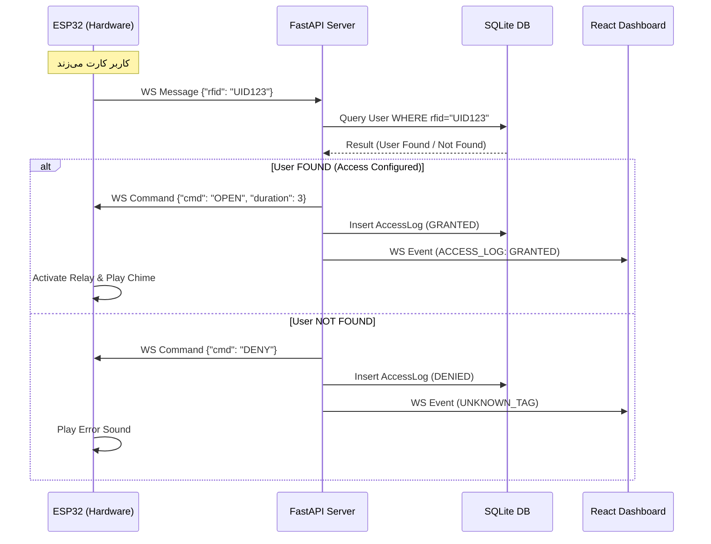

# 🏗️ معماری سیستم SentryGate (System Architecture)

این سند به بررسی عمیق فنی و معماری سیستم SentryGate می‌پردازد. این سیستم بر اساس آخرین استانداردهای توسعه نرم‌افزار و سخت‌افزار طراحی شده است تا پایداری و امنیت حداکثری را فراهم کند.

---

## 🧩 نمای کلی سیستم (System Overview)

سیستم از چهار جزء اصلی تشکیل شده است که در تعامل دائمی با یکدیگر هستند:

1.  **سخت‌افزار (Firmware Layer):** مبتنی بر ESP32 و MicroPython. وظیفه خواندن کارت‌های RFID، کنترل رله (قفل برقی) و پخش هشدارها را بر عهده دارد.
2.  **سرور مرکزی (Backend Layer):** مبتنی بر FastAPI (Python). مغز متفکر سیستم که وظیفه احراز هویت، ثبت لاگ‌ها و مدیریت ارتباطات WebSocket را دارد.
3.  **رابط کاربری (Presentation Layer):** مبتنی بر React و Vite. داشبورد مدیریتی برای مشاهده لحظه‌ای ترددها و مدیریت کاربران.
4.  **زیرساخت (Infrastructure):** مبتنی بر Docker و Nginx. کانتینرایز کردن تمام سرویس‌ها برای استقرار آسان و ایزوله.

---

## 🔄 جریان داده‌ها (Data Flow)

در زیر مسیر کامل یک درخواست از لحظه کشیدن کارت تا باز شدن درب تشریح شده است:

1.  **اسکن کارت (Card Scan):** ماژول RC522 کد UID کارت را می‌خواند.
2.  **ارسال به سرور (Network Transmission):** فریمور ESP32 یک پیام JSON شامل `rfid` و دمای محیط را از طریق WebSocket ایمن به سرور می‌فرستد.
3.  **پردازش در سرور (Processing):**
    *   سرور (`socket_manager.py`) پیام را دریافت می‌کند.
    *   یک کوئری Async به دیتابیس SQLite می‌زند.
4.  **تصمیم‌گیری (Decision Making):**
    *   **اگر کاربر مجاز باشد:** دستور `OPEN` به سخت‌افزار ارسال می‌شود و لاگ `GRANTED` ثبت می‌گردد.
    *   **اگر کاربر ناشناس باشد:** دستور `DENY` ارسال می‌شود و لاگ `DENIED` ثبت می‌گردد.
5.  **پخش همگانی (Broadcasting):** همزمان، سرور یک رویداد به تمام کلاینت‌های فرانت‌‌اند (داشبوردها) می‌فرستد تا لاگ تردد را به صورت آنی نمایش دهند.
6.  **اجرای فیزیکی (Actuation):** سخت‌افزار با دریافت دستور `OPEN`، رله را به مدت ۳ ثانیه فعال کرده و ملودی موفقیت را پخش می‌کند.

---

## 📊 نمودار توالی (Sequence Diagram)

---

## 🛡️ تدابیر امنیتی و پایداری (Security & Reliability)

### 1. امنیت نرم‌افزار (Software Security)
*   **SQL Injection Protection:** تمام کوئری‌های دیتابیس از طریق **SQLAlchemy ORM** انجام می‌شوند که به صورت خودکار ورودی‌ها را Escape کرده و از حملات تزریق SQL جلوگیری می‌کند.
*   **Network Isolation:** سرور Backend روی پورت ۸۰۰۰ ایزوله شده و فقط از طریق شبکه داخلی داکر (`sentrygate-network`) در دسترس Nginx است. دسترسی مستقیم از بیرون مسدود است.

### 2. پایداری سخت‌افزار (Hardware Reliability)
*   **Watchdog Timer (WDT):** یک تایمر نگهبان ۱۵ ثانیه‌ای در فرمور فعال است. اگر پردازنده به هر دلیلی (نویز، هنگ کردن) متوقف شود، سیستم به طور خودکار ریست شده و در کمتر از ۲ ثانیه به مدار باز می‌گردد.
*   **Self-Healing WiFi:** مکانیزم اتصال وای‌فای به گونه‌ای طراحی شده که در صورت قطع شدن مودم، سیستم وارد چرخه تلاش مجدد می‌شود و تا زمان وصل شدن مجدد، به کار خود ادامه می‌دهد.

---

## 📂 ساختار دیتابیس (Database Schema)

مدل داده‌ای سیستم ساده و کارآمد طراحی شده است:

*   **جدول Users:** شامل `id`, `name`, `role`, `rfid_tag`, `created_at`.
*   **جدول AccessLogs:** شامل `id`, `user_name`, `action` (GRANTED/DENIED), `timestamp`, `temperature`.

این ساختار بهینه‌ترین حالت برای کوئری‌های سریع و گزارش‌گیری است.
